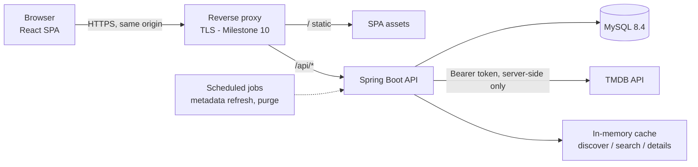

# Architecture

Watchmark is a **modular monolith**: one Spring Boot application, one MySQL
database, one React single-page app. This is enough for the MVP and avoids the
operational cost of distributed services.



In development Vite plays the proxy role: `/api` and `/actuator` are forwarded
to `localhost:8080` (see `frontend/vite.config.ts`).

## Key decisions

| Decision | Why |
|---|---|
| **Same origin for SPA and API** | Session cookies stay first-party (`SameSite=Lax`), no CORS configuration is needed, and CSRF protection is straightforward. |
| **Server-side sessions** | Spring Security + Spring Session JDBC with `HttpOnly`, `SameSite=Lax` (and `Secure` in production) cookies and double-submit CSRF tokens. Logout really revokes the session and JavaScript can never read the credential. A future mobile app can get a separate token-based security filter chain over the same controllers. Details: [security.md](security.md). |
| **Package by feature** | `auth`, `user`, `catalog`, `library`, `tracking`, `calendar`, `stats`, `common`. Each feature holds its own controller, service, repository and DTOs, so tracking logic lives in one place. |
| **Metadata provider interface** | `catalog` talks to a `MetadataProvider`; `TmdbMetadataProvider` and `MockMetadataProvider` implement it. Shows are keyed by `(provider, external_id)`, so a provider change does not touch user data. |
| **Flyway owns the schema** | `ddl-auto=validate`; Hibernate never modifies tables. |
| **UTC everywhere in storage** | `DATETIME(6)` + `Instant`, JDBC session time zone UTC, MySQL server time zone UTC. Conversion to the user's IANA time zone happens only in services that compute "today" and in the UI. |
| **Real MySQL in tests** | Testcontainers runs `mysql:8.4`, the same version as Compose and production. No H2 dialect differences. |

## Backend package layout (target)

```
app.watchmark
├── WatchmarkBackendApplication
├── common/        error handling (RFC 9457 problem+json), shared config
├── auth/          registration, login, sessions, security config
├── user/          profile, time zone, account deletion
├── catalog/       MetadataProvider, TMDB client, metadata entities, refresh job
├── library/       user_shows: status, rating, notes, remove/purge
├── tracking/      episode_watches, tracking_operations, progress, undo, purge job
├── calendar/      upcoming episodes
└── stats/         statistics queries
```

Layering inside a feature: **controller** (HTTP only, no business rules) →
**service** (rules, transactions) → **repository** (persistence). DTOs are Java
records; entities never leave the service layer.

## Frontend layout (target)

```
src/
├── app/         router, layout, providers
├── features/    one folder per feature: API hooks + components
├── pages/       route components that compose features
├── components/  shared UI (PosterCard, ProgressBar, EmptyState, …)
├── lib/         api client, formatting, time zone helpers
└── test/        test setup and helpers
```

Server state lives in TanStack Query. The tracking UI uses optimistic updates
that roll back on error and show an undo toast backed by the server-side
operation (see [tracking-rules.md](tracking-rules.md)).

## Configuration

| Source | Used for |
|---|---|
| `.env` (git-ignored) | Local secrets, read by Compose and by the backend via `spring.config.import`. |
| Environment variables | Production; same keys as `.env.example`. |
| `application.yml` | Non-secret defaults, including `watchmark.tracking.*` retention settings. |
