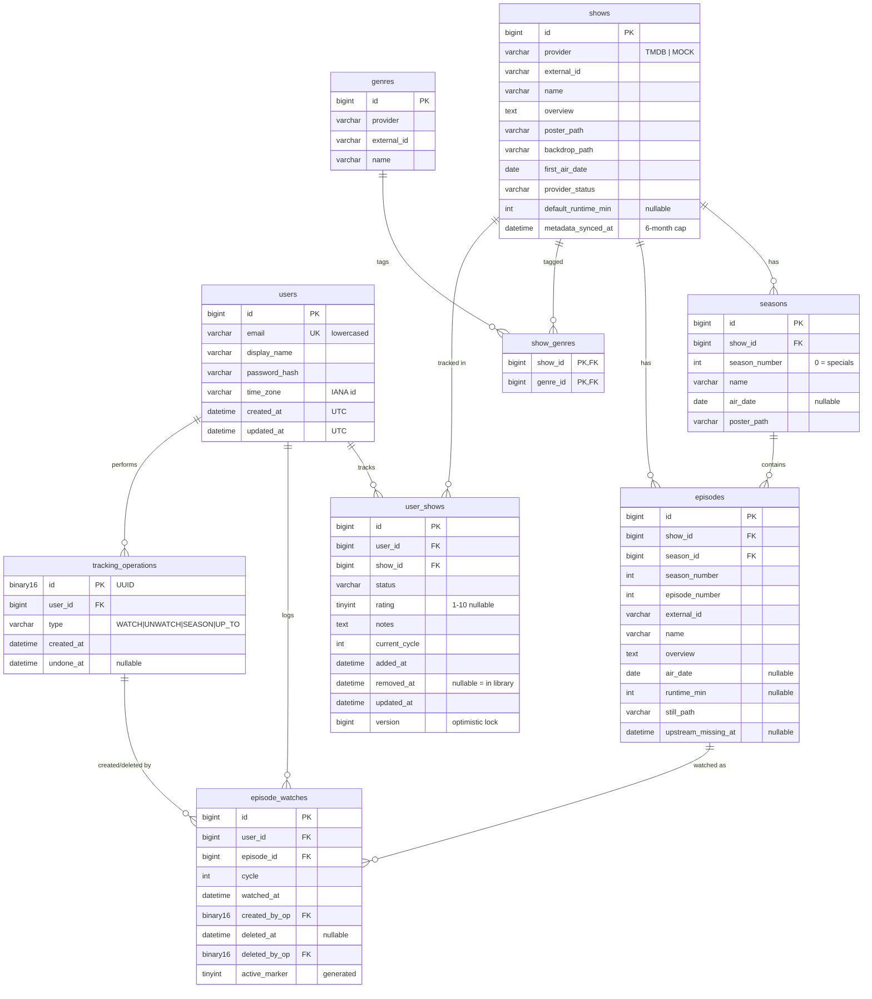

# Data model

Status: **design**. Only `V1__baseline` exists; tables are created by the
milestone that first needs them (see the last column below).

## ER diagram (MVP)



## Tables

| Table | Kind | Purpose | Milestone |
|---|---|---|---|
| `users` | personal | Account, password hash, time zone | 1 |
| `SPRING_SESSION`, `SPRING_SESSION_ATTRIBUTES` | infra | Server-side sessions (Spring Session JDBC MySQL schema) | 1 |
| `shows`, `seasons`, `episodes`, `genres`, `show_genres` | metadata | Cached provider data; refreshable | 3 |
| `user_shows` | personal | Library entry: status, rating, notes, cycle, removed flag | 4 |
| `tracking_operations` | personal | One row per tracking action, for undo | 5 |
| `episode_watches` | personal | One row per viewing event | 5 |

**Deferred** (not created until needed): `user_lists`, `user_list_items`,
`reviews`, follows, notifications. Cast is fetched live and not stored.

## Constraints and indexes

| Table | Constraint |
|---|---|
| `users` | UNIQUE `email` (application lowercases before insert) |
| `shows` | UNIQUE `(provider, external_id)` |
| `seasons` | UNIQUE `(show_id, season_number)` |
| `episodes` | UNIQUE `(show_id, season_number, episode_number)`; INDEX `air_date` |
| `user_shows` | UNIQUE `(user_id, show_id)`; INDEX `(user_id, removed_at, status)`; CHECK `rating BETWEEN 1 AND 10` |
| `episode_watches` | UNIQUE `(user_id, episode_id, cycle, active_marker)`; INDEX `(user_id, watched_at)`; INDEX `deleted_at` for the purge job |

### "At most one active watch" in MySQL

MySQL has no partial indexes. Instead:

```sql
active_marker TINYINT GENERATED ALWAYS AS (IF(deleted_at IS NULL, 1, NULL)) STORED,
UNIQUE KEY uq_watch_active (user_id, episode_id, cycle, active_marker)
```

MySQL treats `NULL`s in a unique key as distinct, so any number of soft-deleted
rows may exist, but only one row with `active_marker = 1` per user, episode
and cycle.

## Foreign keys and deletion

| From → To | ON DELETE | Reason |
|---|---|---|
| personal tables → `users` | CASCADE | Account deletion removes all personal data. |
| `user_shows`, `episode_watches` → metadata | RESTRICT | A metadata refresh can never delete user data. |
| `episode_watches` → `tracking_operations` | RESTRICT | Operations are purged only after their rows (see R12). |

There is **no** foreign key from `episode_watches` to `user_shows`: history is
independent of the library entry (rule R10).

## MySQL conventions

- InnoDB, `utf8mb4`, `utf8mb4_0900_ai_ci`.
- Timestamps: `DATETIME(6)` holding UTC (not `TIMESTAMP`, which ends in 2038).
- Calendar dates from TMDB: `DATE`, never time-zone converted.
- Upserts: `INSERT … ON DUPLICATE KEY UPDATE id = id`, never `INSERT IGNORE`
  (which also suppresses unrelated errors).
- One logical change per Flyway migration: MySQL DDL commits implicitly, so a
  failed multi-statement migration cannot roll back as a whole.
