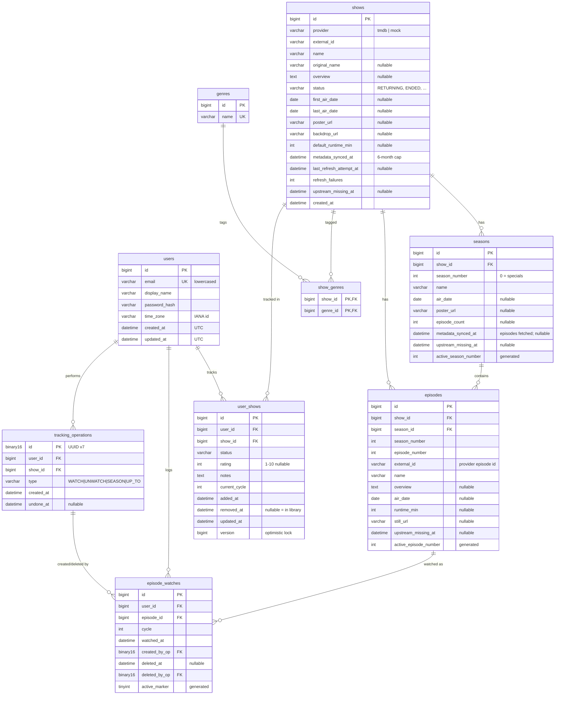

# Data model

Status: `users`, the Spring Session tables (V2, V3) and the metadata tables
`shows`, `genres`, `show_genres`, `seasons`, `episodes` (V4–V7) and the library
table `user_shows` (V8) and the tracking tables `tracking_operations`,
`episode_watches` (V9, V10) exist. Tables are created by the milestone that
first needs them (see the last column below).

## ER diagram (MVP)



## Tables

| Table | Kind | Purpose | Milestone |
|---|---|---|---|
| `users` | personal | Account, password hash, time zone | 1 ✅ |
| `SPRING_SESSION`, `SPRING_SESSION_ATTRIBUTES` | infra | Server-side sessions (Spring Session JDBC MySQL schema) | 1 ✅ |
| `shows`, `seasons`, `episodes`, `genres`, `show_genres` | metadata | Stored provider data needed for tracking; refreshed by a daily job | 3 ✅ |
| `user_shows` | personal | Library entry: status, rating, notes, cycle, removed flag | 4 ✅ |
| `tracking_operations` | personal | One row per tracking action, for undo | 5 ✅ |
| `episode_watches` | personal | One row per viewing event | 5 ✅ |

**Deferred** (not created until needed): `user_lists`, `user_list_items`,
`reviews`, follows, notifications. Cast is fetched live and not stored.

## Constraints and indexes

| Table | Constraint |
|---|---|
| `users` | UNIQUE `email`; column collation `utf8mb4_0900_as_ci` (case-insensitive, accent-sensitive); the application also lowercases before insert |
| `shows` | UNIQUE `(provider, external_id)`; INDEX `metadata_synced_at` |
| `genres` | UNIQUE `name` (case-insensitive, accent-sensitive) |
| `seasons` | UNIQUE `(show_id, active_season_number)`: one active season per number |
| `episodes` | UNIQUE `(show_id, season_number, active_episode_number)`: one active episode per slot; UNIQUE `(show_id, external_id)`; INDEX `air_date`, `season_id` |
| `user_shows` | UNIQUE `(user_id, show_id)`; INDEX `(user_id, removed_at, status)`, `show_id`; CHECK `rating BETWEEN 1 AND 10`, `current_cycle >= 1`, status in the five library statuses; `@Version` optimistic lock |
| `tracking_operations` | INDEX `(user_id, show_id)` for purge (R11), `created_at` for retention (R12); CHECK type in the four operation types |
| `episode_watches` | UNIQUE `(user_id, episode_id, cycle, active_marker)`; INDEX `(user_id, watched_at)`; INDEX `deleted_at` for the purge job; CHECK `cycle >= 1` |

### "At most one active watch" in MySQL

MySQL has no partial indexes. Instead:

```sql
active_marker TINYINT GENERATED ALWAYS AS (IF(deleted_at IS NULL, 1, NULL)) STORED,
UNIQUE KEY uq_watch_active (user_id, episode_id, cycle, active_marker)
```

MySQL treats `NULL`s in a unique key as distinct, so any number of soft-deleted
rows may exist, but only one row with `active_marker = 1` per user, episode
and cycle.

### Stored metadata (Milestone 3)

- Only what tracking, the library, calendar and statistics need is stored.
  Show and season pages still read the provider (through the cache), so
  cast, networks and ratings are not stored.
- Images are stored as the provider's image URLs (references, never copies).
- A refresh **never deletes** rows. Seasons and episodes the provider stops
  listing get `upstream_missing_at` (rule R8) and keep their original numbers;
  the generated `active_*_number` columns are `NULL` for such rows, so the
  unique keys only apply to active rows. Rows reactivate if they reappear.
- Episodes are matched by the provider's episode id, so renumbering, or moving
  an episode to another season, keeps the same row (and therefore, from
  Milestone 5, its watch history).
- The writer reconciles episodes in three flushed phases (mark dropped and
  renumbered rows inactive, move matched rows, insert new rows) because MySQL
  checks unique keys per row and Hibernate runs inserts before updates within a
  flush.
- Provider calls are made before the write transaction opens; any failure
  leaves stored data unchanged.

## Foreign keys and deletion

| From → To | ON DELETE | Reason |
|---|---|---|
| personal tables → `users` | CASCADE | Account deletion removes all personal data. |
| `seasons`, `episodes`, `show_genres` → `shows`; `episodes` → `seasons` | CASCADE | Metadata belongs to its show; a show can only be deleted when no user data references it (next row). |
| `user_shows`, `episode_watches` → metadata | RESTRICT | A metadata refresh can never delete user data. |
| `episode_watches` → `tracking_operations` | RESTRICT | Operations are purged only after their rows (see R12). |
| `tracking_operations` → `shows` | RESTRICT | Each operation records its show so a purge (R11) deletes exactly its operations. |
| `episode_watches`, `tracking_operations` → `users` | CASCADE | Account deletion still deletes rows, then operations, explicitly first, so it never depends on cascade order. |

There is **no** foreign key from `episode_watches` to `user_shows`: history is
independent of the library entry (rule R10).

## MySQL conventions

- InnoDB, `utf8mb4`, `utf8mb4_0900_ai_ci`.
- Timestamps: `DATETIME(6)` holding UTC (not `TIMESTAMP`, which ends in 2038).
- Calendar dates from TMDB: `DATE`, never time-zone converted.
- Upserts: `INSERT … ON DUPLICATE KEY UPDATE id = id`, never `INSERT IGNORE`
  (which also suppresses unrelated errors).
- One logical change per Flyway migration: MySQL DDL commits implicitly, so a
  failed multi-statement migration cannot roll back as a whole.
